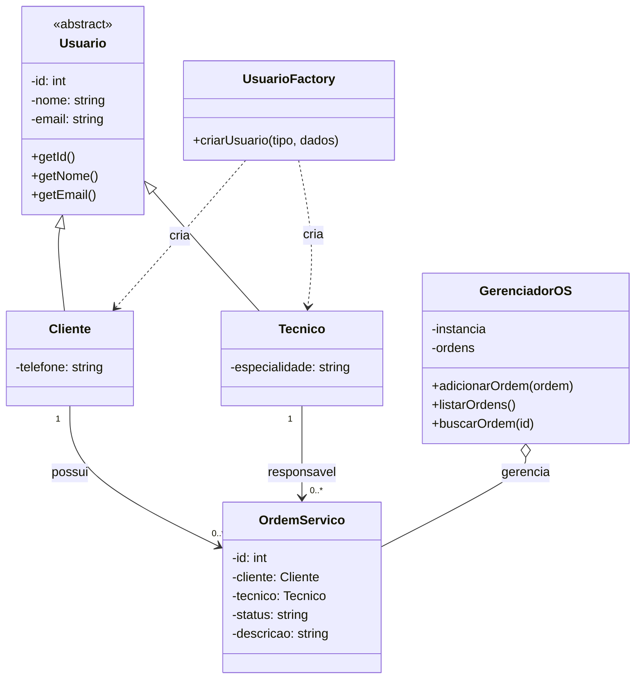

 # TechOS Core

Sistema de gerenciamento de ordens de serviço para uma assistência técnica.

## 1. Histórias de Usuário

### US01 — Criar ordem de serviço

Como técnico, quero abrir uma ordem de serviço para registrar o conserto de um equipamento.

**Critérios de aceitação:**
- CA01: O sistema deve validar o ID do cliente.
- CA02: O status inicial deve ser sempre ABERTA.
- CA03: A ordem deve possuir uma descrição do problema.

### US02 — Consultar ordem de serviço

Como cliente, quero visualizar o status do meu equipamento para acompanhar o andamento do conserto.

**Critérios de aceitação:**
- CA01: O sistema deve permitir consultar uma ordem de serviço pelo seu ID.
- CA02: O sistema deve mostrar o status atual da ordem.
- CA03: Se a ordem não existir, o sistema deve informar que ela não foi encontrada.

## 2. Requisitos Não Funcionais (RNF)

### RNF01 — Segurança

O sistema deve validar as entradas e tratar os dados de forma segura, reduzindo riscos de ataques como Cross-Site Scripting (XSS), conforme as boas práticas da OWASP.

### RNF02 — Desempenho

A criação de uma ordem de serviço deve levar menos de 2 segundos em condições normais de operação.

## 3. Modelagem Orientada a Objetos (POO)

### Usuario
Classe base abstrata que representa os usuários do sistema.

Atributos:
- id: inteiro.
- nome: texto.
- email: texto.

Métodos:
- getId()
- getNome()
- getEmail()

### Cliente
Herda de Usuario.

Atributo adicional:
- telefone: texto.

### Tecnico
Herda de Usuario.

Atributo adicional:
- especialidade: texto.

### OrdemServico
Representa uma ordem de serviço.

Atributos:
- id: inteiro.
- cliente: Cliente.
- tecnico: Tecnico.
- status: texto.
- descricao: texto.

### UsuarioFactory
Responsável por criar objetos Cliente e Tecnico de acordo com o tipo informado.

### GerenciadorOS
Responsável por gerenciar as ordens de serviço, utilizando o padrão Singleton para manter uma única instância do gerenciador.

## 4. Diagrama de Classes

## 5. Padrões Criacionais

- **Factory Method:** utilizado para centralizar a criação de usuários.
- **Singleton:** utilizado para garantir uma única instância do GerenciadorOS durante a execução do sistema.

## 6. Tecnologias

- JavaScript ES6 Modules.
- Node.js.
- Git e GitHub.
